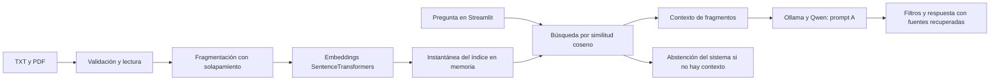

# Asistente IA Profesional

Esta es una copia independiente de portfolio. El desarrollo completo y sus diez
commits se conservan intactos en el repositorio local de desarrollo, por separado.
Esta copia no importa su historial; las referencias a hitos anteriores describen
el desarrollo y no son commits disponibles aquí. Ver [publicación](docs/publicacion.md).

Asistente local para consultar documentos TXT y PDF en lenguaje natural y mostrar
las fuentes recuperadas. Está orientado a explorar una biblioteca pequeña sin
enviar sus textos a un proveedor de generación externo con la configuración local
distribuida. No sustituye la lectura de las fuentes ni garantiza respuestas correctas.

Aplicación RAG con Streamlit, SentenceTransformers y Ollama con `qwen3.5:4b`.
El motor carga embeddings de forma diferida y publica índices coherentes: un fallo
de actualización conserva la versión anterior dentro del proceso.

**Estado:** demo local de portfolio, sin autenticación ni despliegue público.
Persiste una incidencia intermitente HTTP 500 de Ollama correlacionada con un
error de inicialización CUDA; su causa interna no está resuelta. La comparación
CPU/GPU se aplazó por el margen de RAM disponible. Ver
[diagnóstico](docs/diagnostico_ollama.md).

## Cómo funciona



La recuperación habitual selecciona hasta dos fragmentos con umbral 0,20.
Los fragmentos tienen 50 palabras y solapamiento de 10. El índice nuevo se
construye y valida antes de sustituir el activo; cada búsqueda usa una sola
instantánea. No hay base vectorial, persistencia del índice ni entrenamiento del LLM.
Las fuentes mostradas indican recuperación, no certifican la fidelidad de la respuesta.

| Componente | Responsabilidad |
|---|---|
| `app.py` | Interfaz, consultas y estado de guardado/indexación por sesión |
| `documentos.py` / `cargar_documentos.py` | Validación, guardado y lectura TXT/PDF |
| `fragmentar_documentos.py` | Fragmentos con solapamiento |
| `buscador_semantico.py` | `MotorRAG`, índice atómico, recuperación y generación |
| `configuracion.py` / `operacion.py` | Variables de entorno, límites y logging |
| `evaluacion/` | Métricas, revisiones humanas y experimentos de prompts |
| `scripts/` | Instalación aislada y demo local reproducible |

Tecnologías: Python, Streamlit, NumPy, scikit-learn, SentenceTransformers,
PyTorch, requests, pypdf y Ollama. Los modelos se ejecutan por separado de los
tests; el modelo de embeddings es `paraphrase-multilingual-MiniLM-L12-v2`.

## Evidencia y presentación

- 244 tests automáticos correctos en la auditoría H8, con mocks y corpus ficticios.
- Instalación aislada de `a5e3ee0`: 179 tests, imports, tensor CPU y arranque vacío
  de Streamlit correctos. No equivale a validar una instalación limpia de H9.
- H5, validación real revisada manualmente: 9/10 casos satisfactorios y 13/13
  afirmaciones respaldadas; una respuesta fue incompleta.
- H6, reservado: A obtuvo 11/12 casos satisfactorios y C 10/12. Se mantuvo A;
  tres repeticiones idénticas no se cuentan como preguntas independientes.

Los resultados reales anteriores proceden de las validaciones registradas durante
el proyecto. Sus informes locales no se publican; el repositorio contiene baterías
ficticias, código de evaluación y el procedimiento de revisión. La muestra es pequeña
y no prueba ausencia de alucinaciones. Ver [H5](evaluacion/README.md) y
[H6](evaluacion/h6/README.md).

Para entrevistas: [guion técnico y capturas propuestas](docs/portfolio.md).
Antes de publicar: [auditoría y procedimiento GitHub](docs/publicacion.md).

El prompt **A permanece en producción**. B y C son exclusivamente experimentales;
C se descartó por una regresión de completitud. Ver [H5](evaluacion/README.md) y
[H6](evaluacion/h6/README.md). H7 no cambia preguntas, referencias ni métricas.

## Entorno e instalación

Para verificar una instalación limpia **sin tocar la `.venv` actual**, ver
[H8: instalación aislada en Windows](docs/instalacion.md). El modo `Preparar`
exporta un commit a una carpeta temporal y no instala nada. Descargar ruedas e
instalar requieren modos y autorizaciones explícitas diferentes. La Fase A quedó
validada en una instalación temporal independiente del commit `a5e3ee0`: `pip check`,
imports, tensor CPU, 179 tests y arranque de Streamlit con biblioteca vacía correctos.
Ese resultado no valida modelos reales ni todas las plataformas.

Entorno objetivo registrado: Windows x64, CPython 3.14.10, Streamlit 1.67.0,
SentenceTransformers 6.2.0, PyTorch 2.15.0, Transformers 5.22.2 y pypdf 7.0.0.
Las versiones directas están en `requirements.txt`; las 67 dependencias alcanzables
instaladas están fijadas en `requirements-windows-py314.lock.txt`.

La captura se ha utilizado para una **instalación limpia validada en Windows x64,
Python 3.14.10 y PyTorch 2.15.0+cpu**. Los hashes de las ruedas se generaron en el
procedimiento temporal, no están incorporados al lock del repositorio.
No es un lock portable: otro SO, arquitectura, versión de Python o GPU necesita
validar su propio conjunto de ruedas y drivers. No reutilizar versiones antiguas
de PyTorch/NumPy con Python 3.14 por suposición. Los tests con mocks tampoco
verifican el arranque de los modelos reales.

En un ordenador nuevo, desde la raíz del repositorio y usando un entorno nuevo:

```powershell
py -3.14 -m venv .venv
.\.venv\Scripts\python.exe -m pip install -r requirements-windows-py314.lock.txt
.\.venv\Scripts\python.exe -m pip check
.\.venv\Scripts\python.exe -B -m unittest discover -s . -p "test_*.py" -q
```

Este procedimiento es para una instalación controlada; no actualiza el
entorno existente por sí solo. No reutilizar una `.venv` con trabajo previo para
probarlo. En otras plataformas partir de `requirements.txt`, verificar compatibilidad
y registrar las versiones resueltas en un entorno separado antes de desplegar.

Ollama se instala por separado; no es un paquete necesario de este proyecto.
Para las pruebas manuales de IA deben estar preparados previamente `qwen3.5:4b`
y `sentence-transformers/paraphrase-multilingual-MiniLM-L12-v2`. El primer uso de
SentenceTransformers puede descargar pesos si no están en caché. Prepararlos solo
con autorización; los tests automáticos no descargan ni llaman a Ollama.
Registrar versión de Ollama, digest de Qwen, revisión de embeddings y hardware
para reproducibilidad: fijar paquetes no fija los pesos de los modelos.

## Configuración de arranque

`configuracion.py` lee variables de entorno. `.env.example` es solo una referencia:
**no se carga automáticamente** y no necesita `python-dotenv`. No contiene secretos.
Cambiar variables requiere reiniciar Streamlit: no cambiar modelos en caliente.

| Variable | Valor predeterminado |
|---|---|
| `RAG_MODELO_LLM` | `qwen3.5:4b` |
| `RAG_MODELO_EMBEDDINGS` | `sentence-transformers/paraphrase-multilingual-MiniLM-L12-v2` |
| `RAG_URL_OLLAMA` | `http://127.0.0.1:11434/api/generate` |
| `RAG_DOCUMENTOS_DIR` | `Documentos` junto al código |
| `RAG_OLLAMA_TIMEOUT_S` | `120` |
| `RAG_MAX_ARCHIVO_MB` | `10` (MiB) |
| `RAG_MAX_PAGINAS_PDF` | `100` |
| `RAG_MAX_CARACTERES_DOCUMENTO` | `200000` |
| `RAG_MAX_DOCUMENTOS` | `50` |
| `RAG_MAX_PREGUNTA_CARACTERES` | `2000` |
| `RAG_MAX_GENERACIONES` | `1` por proceso, máximo configurable `4` |
| `RAG_PERMITIR_SUBIDAS` | `false` (`true/false` o `1/0`) |
| `RAG_LOG_LEVEL` | `INFO` |

Una ruta relativa se resuelve desde el proyecto, no desde la terminal. Lector y
uploader comparten la ruta. Una carpeta ausente o vacía permite arrancar y buscar
sin cargar modelos. Configuración inválida se rechaza sin imprimir sus valores.
URL/modelos/ruta son decisiones del administrador, no parámetros de visitantes.
La URL exige HTTP(S), `/api/generate` y ausencia de credenciales/query/fragmento.
No enviar documentos a endpoints de terceros sin revisar la política de privacidad.

## Demo local desde VS Code

Para la **demo de portfolio con tres documentos ficticios**, usar el lanzador
[scripts/iniciar_demo.ps1](scripts/iniciar_demo.ps1) y el guion de [demo/README.md](demo/README.md).
Selecciona la `.venv` original, crea una biblioteca temporal nueva, desactiva
subidas y fuerza loopback y modelos desde caché. `-Preparar` permite ensayar sin
servidor; la ejecución de la demo con IA requiere autorización separada.

El ejemplo manual siguiente sirve para probar biblioteca vacía y subidas; no es
el perfil de portfolio (que conserva las subidas desactivadas).

Los siguientes comandos usan el entorno existente, sin instalar nada ni tocar
`Documentos/`. En una terminal PowerShell nueva, desde la raíz:

```powershell
$demoRuta = Join-Path $env:TEMP ("rag-demo-" + [guid]::NewGuid().ToString("N"))
New-Item -ItemType Directory -Path $demoRuta | Out-Null
$env:RAG_DOCUMENTOS_DIR = Join-Path $demoRuta "biblioteca"
$env:RAG_PERMITIR_SUBIDAS = "false"
.\.venv\Scripts\python.exe -B -m streamlit run app.py --server.address=127.0.0.1
```

Abrir `http://127.0.0.1:8501`. Sin documentos, actualizar o buscar debe producir
un resultado controlado y ninguna llamada a modelos. Detener con Ctrl+C.

Para probar subidas ficticias en **esa misma terminal**, después de detener:

```powershell
Set-Content -LiteralPath (Join-Path $demoRuta "horario-ficticio.txt") -Encoding utf8 -Value "El museo de prueba abre los viernes a las 14:00."
$env:RAG_PERMITIR_SUBIDAS = "true"
.\.venv\Scripts\python.exe -B -m streamlit run app.py --server.address=127.0.0.1
```

1. Subir el TXT ficticio creado; con embeddings ya preparados, debe guardarse e indexarse.
2. Subir de nuevo el mismo nombre: debe rechazarse sin sobrescribirlo.
3. Subir un PDF ficticio dañado: debe rechazarse antes de incorporarlo.
4. Con Ollama y pesos ya preparados, preguntar el horario y comprobar fuentes.
5. Parar Ollama y volver a consultar: debe mostrarse un error, no una respuesta técnica del modelo.
6. Revisar consola: eventos y tiempos, sin preguntas, respuestas ni fragmentos.
7. Reiniciar con `RAG_PERMITIR_SUBIDAS=false`: debe desaparecer el uploader.

Las acciones de indexar documentos válidos y generar respuestas sí usan los modelos
reales; se dejan para la validación manual autorizada. La API de agente de Streamlit
no se activa en la configuración distribuida.

## Protecciones y comportamiento documental

- Nombres sin rutas, separadores, controles, nombres reservados de Windows o extensiones ajenas.
- Límites de bytes, páginas, texto extraído y número de documentos, también al leer biblioteca.
- TXT UTF-8 (con BOM opcional), normalizando saltos de línea como antes.
- PDF con cabecera válida y extracción legible; no se admiten subidas cifradas,
  dañadas, vacías ni escaneadas sin texto. No hay OCR ni ejecución de scripts del PDF.
- Validación antes del guardado. Temporal propio `.part`, publicación completa con
  enlace duro sin sobrescritura y limpieza exclusiva de ese temporal. Requiere
  NTFS/ext4 o equivalente local; si no soporta enlaces, se devuelve un error sin
  publicar el documento. Un fallo de limpieza puede dejar un `.part` ignorado por el lector.
- Comprobación de destino y rechazo de enlaces simbólicos/junctions en biblioteca.
- Lectura/publicación coordinadas en el proceso. Dos guardados no pueden saltarse
  la cuota ni sobrescribirse; nombres que solo cambian mayúsculas se consideran duplicados.

Las lecturas existentes de PDF sin texto conservan la compatibilidad anterior:
se omiten. Un PDF existente dañado/cifrado, TXT inválido o límites excedidos impiden
actualizar; el índice previo permanece activo. No se borran ni reparan archivos
existentes automáticamente. Si el guardado válido termina pero falla la indexación,
el archivo permanece para reintentar y la interfaz explica la situación.

El índice vive en memoria y se reconstruye tras reiniciar; no persiste su versión
anterior entre procesos. El administrador debe corregir fuera de la app cualquier
archivo inválido incorporado por otros medios.

## Operación, privacidad y límites pendientes

H8 Fase C añade confirmación de guardado/indexación persistente por sesión e
indicador durante la indexación. Los errores HTTP de Ollama muestran código e ID
de incidencia correlacionados con el log, sin guardar contenido. No hay reintentos
automáticos ni cambios del prompt A. Ver [diagnóstico y evidencias](docs/diagnostico_ollama.md).

Logs estándar `rag` a consola, con fecha, nivel, evento, versión del índice y tiempo.
Sin preguntas, respuestas, fragmentos, rutas documentales ni mensajes originales
de excepciones; tampoco con `DEBUG`. No se crean ficheros de log ni se acumulan
indefinidamente. Si se redirigen a archivos, configurar rotación y retención fuera
de la app. Se suprimen advertencias internas de pypdf para evitar volcar objetos
del documento; los errores se notifican con mensajes propios. La CLI muestra su
respuesta solicitada, pero ya no vuelca el contexto como diagnóstico.

Las generaciones simultáneas excedentes se rechazan con «ocupado», sin cola ni
reintentos ocultos. El límite y los bloqueos son **por proceso**; la carpeta debe
ser controlada por el administrador. No defienden contra otro proceso con permisos
de escritura que cambie archivos/enlaces durante la operación. No usar réplicas ni
carpetas de red para esta demo.

Los límites de PDF reducen consumo, pero no garantizan tiempo/memoria máximos ante
un PDF comprimido hostil: el parser se ejecuta en proceso. Por eso esta demo es
local y de acceso controlado. No hay autenticación ni aislamiento multiusuario:
las sesiones comparten biblioteca e índice. No admitir documentos privados de
usuarios distintos ni abrir puertos a Internet. Ollama permanece local.

`.streamlit/config.toml` fija 127.0.0.1, CORS/XSRF activos, errores genéricos en el
navegador y sin estadísticas de uso. `server.maxUploadSize=10` es el valor global
de reserva; en Streamlit 1.67 el parámetro explícito del widget lo sustituye por
`RAG_MAX_ARCHIVO_MB`. El módulo documental vuelve a comprobar los bytes recibidos.
Las variables/flags de
Streamlit pueden sobrescribir el TOML; no utilizar `0.0.0.0` ni desactivar protecciones.

El prompt A y la lógica del filtro de años se conservan. Quitar sus prints cambia
la huella de implementación del filtro, no sus reglas. Los informes históricos H5/H6
no se reescriben. Para comparaciones históricas usar los artefactos originales y
las condiciones registradas; no reutilizar selecciones congeladas con otra huella.
Los scripts H5/H6 conservan su código: mantener sus condiciones predeterminadas
(especialmente timeout 120) para no atribuirles configuración no registrada.
Ni el filtro ni las fuentes garantizan fidelidad: sigue siendo necesaria revisión
humana para usos relevantes. B/C no se promocionan.

Los documentos personales, informes, `.venv`, `.env` y secretos siguen excluidos
de Git. `.env.example` es la única excepción de ejemplo. Si se configura otra
carpeta dentro del repositorio, excluirla antes de guardar documentos; preferir
una carpeta externa como en la demo.

## Verificación automática

```powershell
.\.venv\Scripts\python.exe -m pip check
.\.venv\Scripts\python.exe -B -m unittest discover -s . -p "test_*.py" -q
git diff --check
```

Los tests conservan los 144 comportamientos previos y añaden configuración,
documentos y operación. Usan temporales, mocks de modelos y HTTP, sin documentos
personales. No ejecutan las evaluaciones reales. Ver [tests/README.md](tests/README.md).
H8 añade también pruebas de instalación simulada y de aislamiento del lanzador de
demo, sin instalar paquetes ni ejecutar modelos. Los 179 tests de la Fase A
corresponden al código exportado de `a5e3ee0`, no al total de tests de la copia de trabajo.

## Licencia

El código y la documentación del proyecto se distribuyen bajo la licencia
[MIT](LICENSE). Copyright (c) 2026 Javier Esteban.
Las dependencias y los modelos conservan sus respectivas licencias; no se incluyen
sus paquetes ni pesos en este repositorio.
